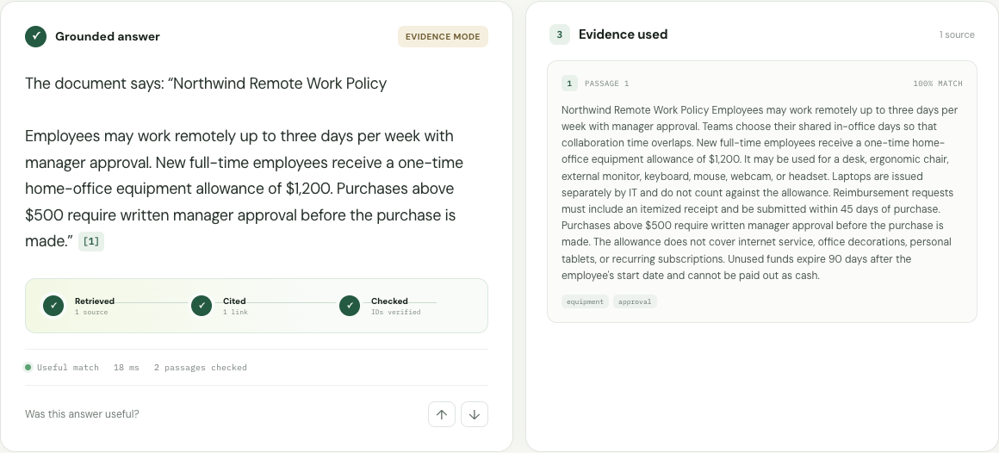
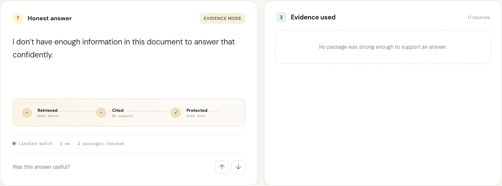
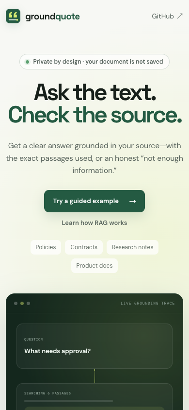

<p align="center">
  
</p>

<h1 align="center">Groundquote</h1>

<p align="center"><strong>Ask the text. Check the source.</strong></p>

<p align="center">
  <a href="https://groundquote.vercel.app">Live app</a> ·
  <a href="https://groundquote.vercel.app/#learn-rag">Learn RAG</a> ·
  <a href="https://github.com/eatusc-personal/groundquote/actions/workflows/ci.yml">CI</a> ·
  <a href="LICENSE">MIT License</a>
</p>

<p align="center">
  
</p>

Groundquote is a focused retrieval-augmented generation product for policies,
contracts, research notes, and technical documentation. Paste or upload text,
ask one question, and get a short answer backed by the exact source passages.
When the document does not contain enough evidence, Groundquote says so.

It is a public demo, deliberately small enough to understand in one sitting,
built with the checks a real deployment needs: citation validation, safe
abstention, request limits, and a test suite that covers all of them.

**[Try Groundquote live →](https://groundquote.vercel.app)**

## See the two paths

The supported-answer path cites the passage it used. The safe path is just as
important: when the document is silent, Groundquote says so and shows no
pretend evidence.

| Cited answer | Safe no-answer | Phone layout |
| --- | --- | --- |
| [](docs/screenshots/grounded-answer.png) | [](docs/screenshots/safe-no-answer.png) | [](docs/screenshots/mobile.png) |

## Why this exists

Many document-chat demos optimize for a fluent answer. Groundquote optimizes for a
*verifiable* answer:

- Every generated claim must contain an inline source citation.
- Citation IDs are validated by application code, not trusted from the model.
- Weak retrieval takes a safe no-answer path.
- Uploaded text is processed for the request and is not persisted by the app.
- Source text is treated as untrusted data to reduce prompt-injection risk.
- A helpful / not-helpful control creates a lightweight human evaluation loop.
- If the model API is unavailable, the product still returns transparent,
  extractive evidence instead of failing or inventing an answer.

## How it works

```text
document → clean + chunk → BM25 keyword ranking ─┐
                                                  ├→ rank fusion → top evidence
question → embedding → semantic ranking ─────────┘
                                                         ↓
                                              evidence-constrained answer
                                                         ↓
                                       validate citations or safely abstain
```

The semantic branch is enabled when `OPENAI_API_KEY` is configured. Retrieval
falls back to deterministic BM25 ranking if embeddings are unavailable.

## Features

- Animated question → retrieval → citation trace
- “RAG in 60 seconds” learning lab and abstention challenge
- A longer [plain-English RAG guide](https://groundquote.vercel.app/learn/rag)
- Text, Markdown, CSV, and JSON input
- Clickable inline citations and visible evidence passages
- Retrieval confidence, method, latency, and passage-count diagnostics
- Safe no-answer behavior
- Helpful / not-helpful feedback
- Responsive UI, reduced-motion support, custom icon, and PWA manifest
- Search metadata, sitemap, structured application and FAQ data
- `llms.txt` and expanded machine-readable project context
- Cookie-free, anonymized Vercel Web Analytics
- Native sharing with a clipboard fallback

## Run locally

Requires Node.js 20.9 or newer.

```bash
npm install
cp .env.example .env.local
npm run dev
```

Open [http://localhost:3000](http://localhost:3000). The app works immediately
in evidence-only mode. Add `ANTHROPIC_API_KEY` for Claude-written answers and `OPENAI_API_KEY` for hybrid
retrieval.

## Environment variables

| Variable | Required | Purpose |
| --- | --- | --- |
| `ANTHROPIC_API_KEY` | No | Claude writes the cited answers |
| `ANTHROPIC_MODEL` | No | Defaults to `claude-opus-5-5` |
| `OPENAI_API_KEY` | No | Enables embeddings; writes answers when no Anthropic key is set |
| `OPENAI_MODEL` | No | Defaults to `gpt-5.6-luna` |
| `OPENAI_EMBEDDING_MODEL` | No | Defaults to `text-embedding-3-small` |
| `SUPABASE_URL` | No | Enables aggregate anonymous feedback |
| `SUPABASE_SERVICE_ROLE_KEY` | No | Server-only key for feedback writes |
| `NEXT_PUBLIC_SITE_URL` | No | Canonical deployment URL |

Never prefix the service-role key with `NEXT_PUBLIC_`.

## Persist anonymous ratings

Groundquote always remembers a rating in the visitor's browser. To also collect
aggregate ratings:

1. Create a Supabase project.
2. Run [`supabase/schema.sql`](supabase/schema.sql) in the SQL editor.
3. Add `SUPABASE_URL` and `SUPABASE_SERVICE_ROLE_KEY` to the server environment.

Only the answer ID, helpful/not-helpful choice, answer mode, and timestamp are
stored. Document text and questions are not included.

## Quality checks

```bash
npm run lint
npm run typecheck
npm run test:run
npm run eval
npm run test:e2e
npm run audit:prod
npm run build
```

Or run the complete release check:

```bash
npm run test:all
```

The current suite has 61 automated checks: 50 unit and API tests, 8 real-browser
scenarios, and 3 retrieval evaluations. It covers chunking, ranking, duplicate
evidence, citation validation, safe abstention, malformed requests, origin and
payload limits, feedback behavior, mobile layout, keyboard navigation, WCAG A
and AA checks, and public crawler files.

Read the [full scenario matrix](docs/test-matrix.md). The small evaluation set
in [`evals/cases.json`](evals/cases.json) is designed to grow whenever a real
failure appears.

## Security and privacy

- API credentials remain server-only.
- Request content type, body size, origin, and schema are validated.
- Public routes have request and payload limits.
- Responses containing retrieval results use `Cache-Control: no-store`.
- Source passages are labeled untrusted and cannot issue model instructions.
- Generated citation IDs are validated against the retrieved evidence.
- CSP, HSTS, frame restrictions, MIME protection, browser-permission limits,
  and cross-origin isolation headers are enabled.
- Document text and questions are not stored in the feedback table.

Read the public [privacy explanation](https://groundquote.vercel.app/privacy)
and [`SECURITY.md`](SECURITY.md). The hosted demo is not intended for secrets or
regulated information.

The included limiter is process-local and intentionally small. A high-traffic
operator should add a distributed limiter and provider-level usage caps.

## Search and AI discoverability

Groundquote publishes:

- canonical metadata and indexable crawler directives;
- Open Graph and Twitter sharing images;
- a generated XML sitemap and `robots.txt`;
- `WebApplication` and `FAQPage` JSON-LD;
- [`llms.txt`](public/llms.txt) and
  [`llms-full.txt`](public/llms-full.txt);
- semantic, plain-language explanations visible in the rendered page.
- a dedicated [RAG explainer](https://groundquote.vercel.app/learn/rag) with
  `TechArticle` data.

These files make the product easier for search engines and text-based agents to
understand; they do not guarantee ranking or inclusion.

## Deploy

The fastest path is Vercel:

1. Import this GitHub repository into Vercel.
2. Add `ANTHROPIC_API_KEY` and `OPENAI_API_KEY` as encrypted environment variables.
3. Add a monthly API usage limit and deploy.
4. Optionally configure Supabase feedback using the steps above.

The public API applies request-size limits and a best-effort in-memory rate
limit. For a high-traffic deployment, replace it with a distributed limiter
such as Vercel KV or Upstash Redis.

## Deliberate boundaries

- Text, Markdown, CSV, and JSON are supported; PDF parsing is deliberately out
  of scope to keep the trust boundary and deployment small.
- Documents are limited to 60,000 characters.
- This is single-document question answering, not a persistent knowledge base.
- Retrieval confidence is a useful signal, not a calibrated probability.

## Stack

Next.js, TypeScript, Claude API (structured outputs), OpenAI embeddings, Zod, Vitest,
Playwright, Axe, Vercel Web Analytics, and optional Supabase feedback storage.

## Contributing

Focused issues and pull requests are welcome. Read
[`CONTRIBUTING.md`](CONTRIBUTING.md) and never include sensitive document text
in a bug report.

## License

MIT
